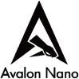

# Canaan SDK (canaan_sdk_for_linux) Open Source Policies

## Open Source Trademark Policy

Canaan Creative Co., Ltd. open source projects may include trademarks and
logos, such as the word marks Avalon, AvalonMiner, Canaan and Kendryte,
,
 (hereinafter referred to as
the Trademarks), which are trademarks of Canaan Creative Co., Ltd. or its
affiliates. If you'd like to use the Trademarks outside the scope of this
policy, please email us at legal@canaan-creative.com.

The logos appear in this repository in:

- `docs/trademarks/avalon-pic1.png`, `docs/trademarks/avalon-pic2.png`
- `product/k230/miner/avalon-home/nano3s/files/lcd_img/screen_pic/logo_b.png`
  (LCD logo)
- the images embedded in `apps/miner-web/assets/*.html` (web pages)
- `board/canaan/k230_nano3s/avalon_logo.h` in the U-Boot tree, added by the patches in
  `product/k230/common/recipes-bsp/u-boot/files/` (U-Boot boot logo)

## Nominative Fair Use Allowed

You may use our open source project names for discussion, commentary, and
criticism, so long as your use does not suggest sponsorship, endorsement, or
affiliation between you or any third party and Canaan SDK (canaan_sdk_for_linux).
You may not use our open source logos without permission.

## Unauthorized Use

You may not use the Trademarks in a manner inconsistent with this policy
without written permission. Please do not use the Trademarks as open source
project names, domain names, usernames, mobile app names, or company names. As
an example, you may not use the Trademarks (or any of Canaan's non-OSS
trademarks) in the name of any software project.

## Copyright licenses and trademarks

The copyright licenses of this repository (MIT, GPL and the other licenses
named in `NOTICE`) do not grant any right to use the Trademarks or any
other trademark.

## Third-party marks

Linux® is the registered trademark of Linus Torvalds in the U.S. and other countries.

The Bluetooth word mark and logos are registered trademarks owned by
Bluetooth SIG, Inc.

"QR Code" is a registered trademark of DENSO WAVE INCORPORATED.

The USB icon is a trademark of USB Implementers Forum, Inc.
